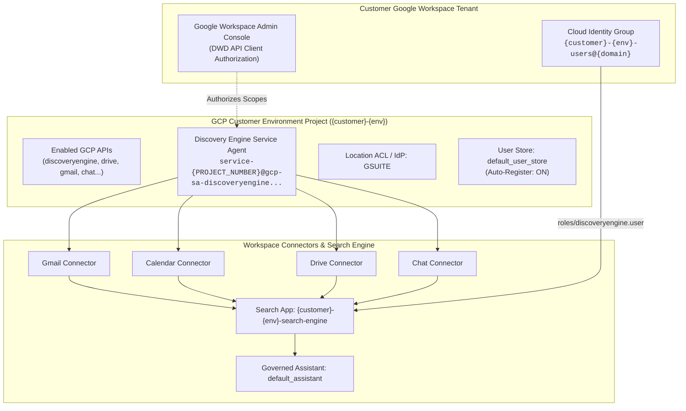

# Gemini Enterprise Customer Provisioning IaC

This repository contains production-grade Terraform Infrastructure as Code (IaC) to provision and configure Gemini Enterprise (Vertex AI Search) for Google Workspace.

It deploys:
- **Dedicated GCP Projects** per configurable customer environment (e.g. `non-prod`, `prod`, `dev`, `pilot`).
- **Discovery Engine Service Agents** pre-created with Domain-Wide Delegation (DWD) authorization metadata.
- **Location Identity Provider (IdP)** natively configured to `GSUITE` via `google_discovery_engine_acl_config`.
- **Cloud Identity User Groups** and IAM search engine role bindings (`roles/discoveryengine.user`).
- **User Store with Auto-Registration** (`google_discovery_engine_user_store`).
- **Federated Workspace Connectors** (`google_mail`, `google_calendar`, `google_drive`, `google_chat`).
- **Unified Intranet Search App & Governed Assistant** (`google_discovery_engine_search_engine`, `google_discovery_engine_assistant`).
- **Automated Seat Distribution & Verification** tooling.

---

## Architecture Overview



### Why Location is Global
The `location` variable defaults to `global`. In Gemini Enterprise federated Workspace search (Gmail, Calendar, Drive, Chat), queries are federated directly against Google Workspace APIs in real-time under user credentials and are not ingested or copied into GCP persistent data stores. Google Workspace connectors currently require the Discovery Engine resources to reside in the `global` location.

---

## Prerequisites

1. **Google Cloud Platform**:
   - An active GCP Cloud Billing Account (e.g. `0X1XXX-XXXXXX-XXXXXX`).
   - A GCP folder or organization where projects will be created.
   - Terraform `v1.5+` installed locally or in CI.
   - Local authentication:
     ```bash
     gcloud auth application-default login
     ```

2. **Google Workspace**:
   - Google Workspace Customer ID (e.g. `C01234567`) and primary domain (`example.com`).
   - Workspace Administrator access to authorize Domain-Wide Delegation at [admin.google.com](https://admin.google.com/ac/owl/domainwidedelegation).

3. **Gemini Enterprise Subscription**:
   - Subscription purchased at the Cloud Billing Account level with available license seats.

---

## Configuration

Copy the example variables file to create your active configuration:

```bash
cp terraform.tfvars.example terraform.tfvars
```

Edit `terraform.tfvars` with your customer environment settings:

```hcl
customer_id           = "example-customer"
customer_name         = "Example Customer"
environments          = ["non-prod", "prod"]
company_domain        = "example.com"
workspace_customer_id = "C01234567"
billing_account       = "0X1XXX-XXXXXX-XXXXXX"
folder_id             = "123456789012"

# Staged rollout flag (leave false for Stage 1)
enable_connectors     = false
workspace_connectors  = ["google_mail", "google_calendar", "google_drive", "google_chat"]

# Seat quota allocations per environment
seat_allocations = {
  prod     = 4
  non-prod = 1
}
```

---

## Staged Deployment Runbook

Deploying Gemini Enterprise with federated Workspace connectors involves an unavoidable one-time Workspace Admin authorization gate. The configuration is intentionally staged into two safe apply steps:

### Stage 1: Deploy Foundation Infrastructure

Provisions the GCP projects, APIs, Discovery Engine service agent identity, IdP configuration, Cloud Identity user groups, user store, and single source of truth license allocations file.

```bash
terraform init
terraform apply
```

Review the output checklist for Domain-Wide Delegation:

```bash
terraform output -json dwd_checklist
```

### Stage 2: Workspace Admin Domain-Wide Delegation (DWD)

1. Open the [Google Workspace Admin Console - Domain-Wide Delegation](https://admin.google.com/ac/owl/domainwidedelegation).
2. Click **Add new**.
3. For each environment project from the `terraform output dwd_checklist`:
   - **Client ID**: Copy the `service_agent_email` (format: `service-<PROJECT_NUMBER>@gcp-sa-discoveryengine.iam.gserviceaccount.com`).
   - **OAuth Scopes**: Paste the comma-separated `oauth_scopes_csv` string:
     ```
     https://www.googleapis.com/auth/admin.directory.user.readonly,https://www.googleapis.com/auth/admin.directory.group.readonly,https://www.googleapis.com/auth/admin.directory.group.member.readonly,https://www.googleapis.com/auth/gmail.readonly,https://www.googleapis.com/auth/calendar.readonly,https://www.googleapis.com/auth/drive.readonly,https://www.googleapis.com/auth/chat.spaces.readonly,https://www.googleapis.com/auth/chat.messages.readonly,https://www.googleapis.com/auth/chat.memberships.readonly
     ```
   - Click **Authorize**.
4. In the Google Workspace Admin Console under **Security > Access and data control > API controls > Google Cloud Core Services**, ensure each environment GCP Project is allowed access.

### Stage 3: Deploy Connectors, Search Engines & Assistants

Once DWD is authorized, enable connectors in `terraform.tfvars` or pass the flag:

```bash
terraform apply -var="enable_connectors=true"
```

This provisions:
- Google Mail, Google Calendar, Google Drive, and Google Chat federated connectors.
- The unified Discovery Engine Search Application.
- Engine-level IAM permissions for the customer user groups.
- The governed Gemini Enterprise Assistant with web grounding and custom instructions.

### Stage 4: Distribute Subscription Licenses

Distribute license seats from your Cloud Billing Account pool to target projects using the automated script:

```bash
# Preview distribution and verify project numbers & billing pool capacity
python3 scripts/allocate_licenses.py --distribute --dry-run

# Execute distribution
python3 scripts/allocate_licenses.py --distribute
```

### Stage 5: End-to-End Verification

Run the verification script to inspect all components across environments:

```bash
python3 scripts/verify.py
```

The script validates:
- Status of all Workspace data connectors (`ACTIVE`)
- Search engine and assistant health
- Project-level distributed license configs and assigned seat quotas
- User store auto-registration setting
- Direct links to the Vertex AI Search application console

---

## File Structure

```
├── .github/workflows/
│   └── terraform.yml               # CI: terraform fmt and validate
├── config/
│   ├── license_allocations.example.json # Example seat allocation schema
│   └── license_allocations.json         # Generated runtime allocation (gitignored)
├── scripts/
│   ├── allocate_licenses.py        # License distribution & auto-registration tool
│   └── verify.py                   # Post-deployment validation script
├── bootstrap.sh                    # Helper script for initial SA setup
├── main.tf                         # Core Terraform resources
├── outputs.tf                      # Terraform outputs & DWD checklist
├── providers.tf                    # Google & Google-Beta providers
├── terraform.tfvars.example        # Example sanitized variable definitions
├── variables.tf                    # Input variable declarations
├── versions.tf                     # Provider & Terraform version constraints
├── todo.md                         # Deployment checklist
└── licenses.md                     # Deep-dive licensing architecture reference
```
