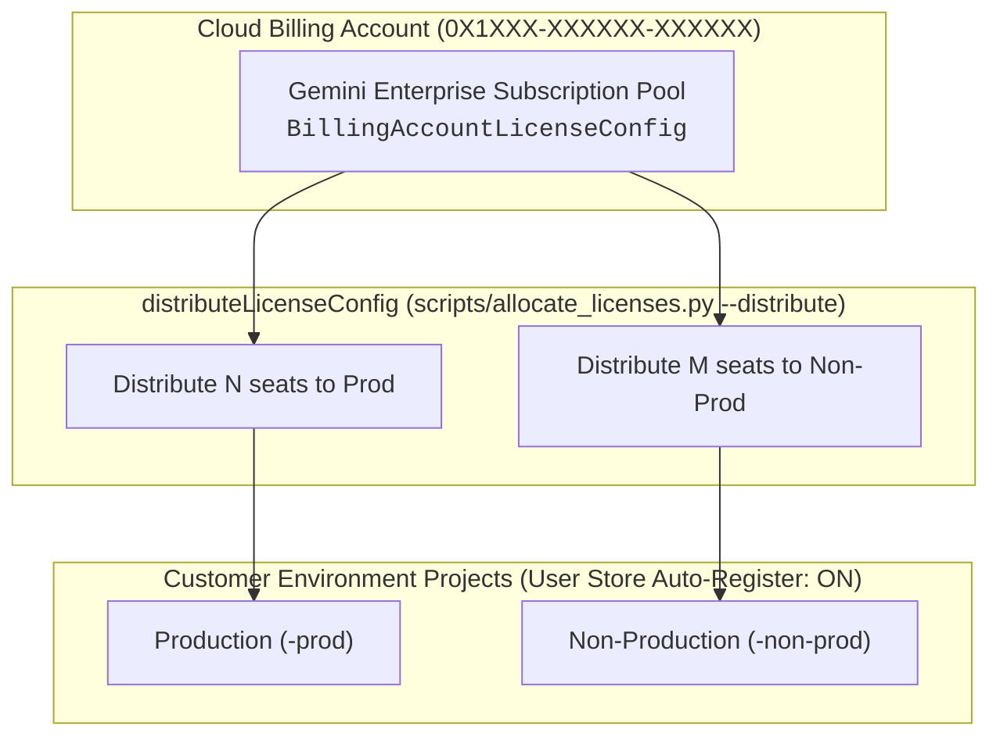

# Gemini Enterprise License Allocation & Operational Guide

This document captures architectural design, Google API requirements, and operational procedures for managing Gemini Enterprise seat licenses across customer environment GCP projects (e.g. `prod` and `non-prod`).

---

## 1. Executive Summary & Configuration

### Subscription Overview
* **Subscription Name**: Primary Gemini Enterprise Subscription
* **Subscription ID**: `<SUBSCRIPTION_ID>`
* **Billing Account License Config ID**: `<LICENSE_CONFIG_ID>`
* **Billing Account ID**: `0X1XXX-XXXXXX-XXXXXX`
* **Subscription Tier**: `Gemini Enterprise Standard`
* **Target Quota Distribution**: Configured per customer environment in `seat_allocations` variable and emitted to `config/license_allocations.json`.

### Customer Environment Quota Allocations
Generated automatically by Terraform in [`config/license_allocations.json`](config/license_allocations.json):

| Environment | Project ID | Project Number | Target Quota | Status |
| :--- | :--- | :---: | :---: | :---: |
| **Production** | `<customer_id>-prod` | `<PROJECT_NUMBER_PROD>` | e.g. 4 seats | Active |
| **Non-Production** | `<customer_id>-non-prod` | `<PROJECT_NUMBER_NON_PROD>` | e.g. 1 seat | Active |

---

## 2. Architecture & Operational Workflow



---

## 3. Operational CLI Commands

### 1. Distribute Subscription Seats from Billing Account to Projects
Distributes seat quota from the central Billing Account pool to target customer project numbers:
```bash
# Dry run preview (performs preflight assertions without mutating state)
python3 scripts/allocate_licenses.py --distribute --dry-run

# Execute distribution
python3 scripts/allocate_licenses.py --distribute
```

### 2. Configure Auto-Registration on Target Projects
Configures each project's `default_user_store` to bind to its distributed license config so users automatically receive seats upon login:
```bash
# Dry run preview
python3 scripts/allocate_licenses.py --configure-auto-register --dry-run

# Apply configuration
python3 scripts/allocate_licenses.py --configure-auto-register
```

### 3. Verify Active Allocations & Status
Displays the real-time license configurations and assigned quota across all customer environment projects:
```bash
python3 scripts/allocate_licenses.py --list
```

### 4. Verify End-User Search Access
Log in to the customer search application using an Incognito window:
* **Production Console**: `https://console.cloud.google.com/gen-app-builder/engines?project=<customer_id>-prod`

---

## 4. Minimal IAM Permission Requirements

To execute seat distribution from the Cloud Billing Account, the executing principal requires:
* `discoveryengine.billingAccountLicenseConfigs.distribute` on the Cloud Billing Account.
* `roles/discoveryengine.admin` on the environment projects.
* `roles/resourcemanager.projectViewer` on the environment projects (to run preflight validation).

---

## 5. Billing Account Licensing Architecture

1. **Central Subscription Model**:
   * Gemini Enterprise subscriptions are purchased at the Cloud Billing Account level and provisioned to project numbers via `billingAccounts.billingAccountLicenseConfigs.distributeLicenseConfig`.
   * Unused quota can be released back to the central pool using `billingAccounts.billingAccountLicenseConfigs.retractLicenseConfig`.
2. **Project License Configs**:
   * Once distributed, a project-level `licenseConfigs/<id>` resource becomes active in the target project.
3. **User Store Auto-Registration**:
   * The project's `default_user_store` resource is configured with `default_license_config` and `enable_license_auto_register = true`, ensuring users are granted seats on their first application login without manual seat assignment.
