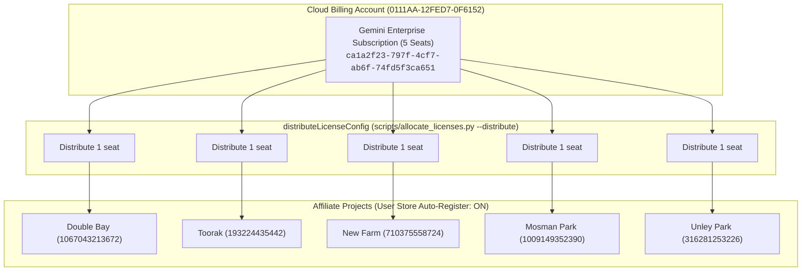

# Gemini Enterprise License Allocation & Troubleshooting Guide

This document captures the complete findings, architectural design, Google API requirements, and actionable next steps for managing Gemini Enterprise licenses across the 7 Australian affiliate GCP projects.

---

## 1. Executive Summary & Configuration

### Subscription Overview
* **Subscription Name**: `affiliate_main_reservation`
* **Subscription ID**: `05eab18d-9cd5-4ba6-966f-ff796c7d27a8`
* **Billing Account License Config ID**: `ca1a2f23-797f-4cf7-ab6f-74fd5f3ca651`
* **Billing Account ID**: `0111AA-12FED7-0F6152`
* **Subscription Tier**: `Gemini Enterprise Standard`
* **Total Subscription Capacity**: 5 seats
* **Target Quota Distribution**: 1 seat per project for 5 affiliate projects, skipping 2 projects (Sandy Bay & Fannie Bay)

### Affiliate Quota Allocations
Configured in [`config/license_allocations.json`](file:///Users/pcorreia/dev/ge/affiliate-provisioning/config/license_allocations.json):

| Affiliate Name | Project ID | Project Number | Allocated Quota | Status |
| :--- | :--- | :---: | :---: | :---: |
| **Double Bay** | `rwg-double-bay` | `1067043213672` | 1 seat | Active |
| **Toorak** | `rwg-toorak` | `193224435442` | 1 seat | Active |
| **New Farm** | `rwg-new-farm` | `710375558724` | 1 seat | Active |
| **Mosman Park** | `rwg-mosman-park` | `1009149352390` | 1 seat | Active |
| **Unley Park** | `rwg-unley-park` | `316281253226` | 1 seat | Active |
| **Sandy Bay** | `rwg-sandy-bay` | `98284566703` | 0 seats | *Skipped* |
| **Fannie Bay** | `rwg-fannie-bay` | `73146909050` | 0 seats | *Skipped* |

---

## 2. Architecture & Operational Workflow



---

## 3. Operational CLI Commands

### 1. Distribute Subscription Seats from Billing Account to Projects
Distributes seat quota from the central Billing Account pool to target affiliate project numbers:
```bash
# Dry run preview
python3 scripts/allocate_licenses.py --distribute --dry-run

# Execute distribution
python3 scripts/allocate_licenses.py --distribute
```

### 2. Configure Auto-Registration on Target Projects
Binds each project's `default_user_store` to its distributed license config so users automatically receive seats upon login:
```bash
# Dry run preview
python3 scripts/allocate_licenses.py --configure-auto-register --dry-run

# Apply configuration
python3 scripts/allocate_licenses.py --configure-auto-register
```

### 3. Verify Active Allocations & Status
Displays the real-time license configurations and assigned quota across all affiliate projects:
```bash
python3 scripts/allocate_licenses.py --list
```

### 4. Verify End-User Search Access
Log in to the affiliate search application using an Incognito window:
* **Double Bay Console**: [Vertex AI Search - Double Bay App](https://console.cloud.google.com/gen-app-builder/engines?project=rwg-double-bay)

---

## 4. Minimal IAM Permission Requirements

To execute seat distribution from the Cloud Billing Account, the executing principal requires:
* `discoveryengine.billingAccountLicenseConfigs.distribute` on Billing Account `0111AA-12FED7-0F6152`.

---

## Appendix: Archived Legacy Findings & Deprecations

> [!NOTE]
> The following findings document the evolution from legacy project-level licensing to the current Billing Account model:

1. **Project-Level Creation Deprecated**:
   * Google Cloud returned: `"License Config creation has been deprecated at the project level for Gemini Enterprise."`
   * Direct creation via `projects.locations.licenseConfigs.create` is no longer supported.
2. **Central Subscription Architecture**:
   * Subscriptions are created at the Billing Account level and provisioned to project numbers via `billingAccounts.billingAccountLicenseConfigs.distributeLicenseConfig`.
   * Unused quota can be released back to the central pool using `billingAccounts.billingAccountLicenseConfigs.retractLicenseConfig`.
3. **Multi-Project Account Access**:
   * A single user principal (e.g. `pcorreia@pcorreia.altostrat.com`) can access multiple affiliate projects independently.

